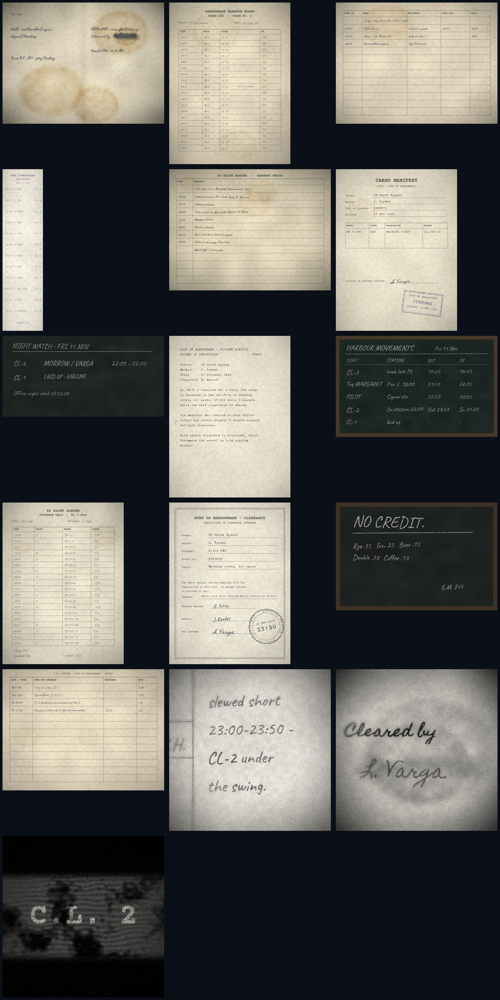
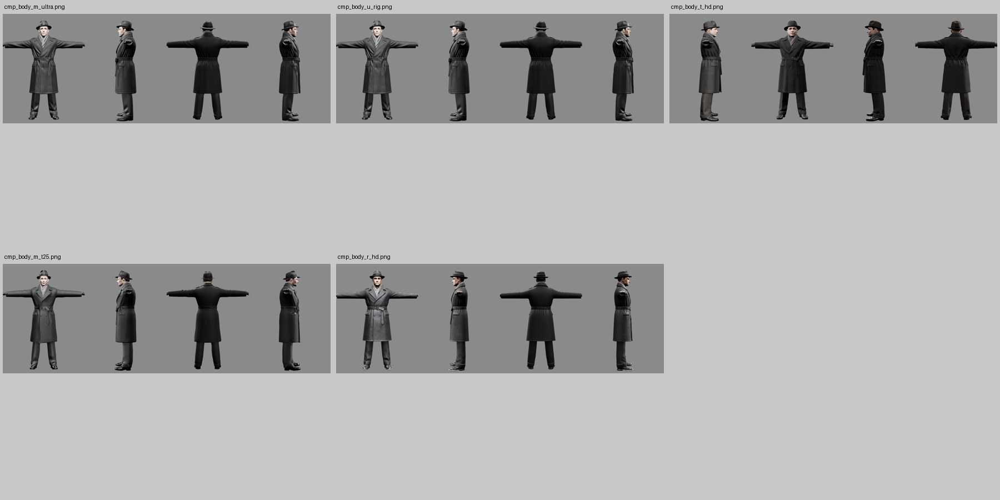
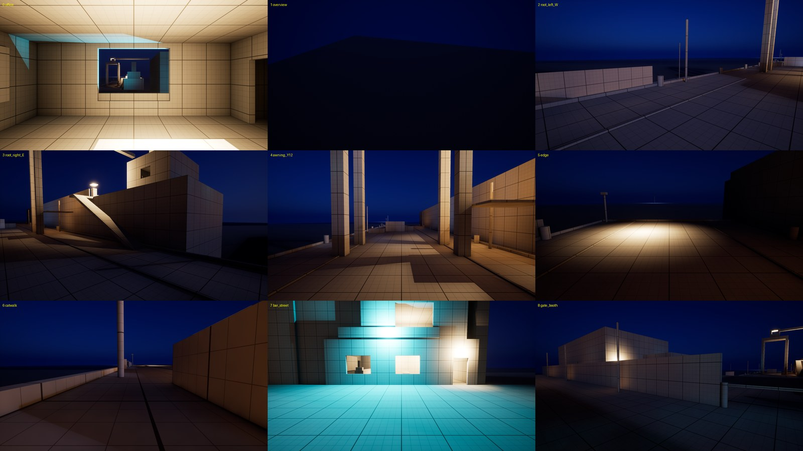

# Dev log

Public development log for the jam submission (required for the Glass Box award: "best dev log showing
how you built your game"). The docs role adds an entry after each batch of merges; the owner publishes
it (itch.io devlog on the game page, linked in the submission form).

Rules for every entry:

- Write only verified facts (merged commits, checker output, screenshots you looked at).
- No secrets, emails or local paths outside the repository.
- **No spoilers.** The solution of Case 1 stays out of this file until the owner publishes the
  post-jam entry. Source material that does contain it lives in `docs/devlog/DECISIONS.md` (internal).
- Show the process, not only the result: what was tried, what was rejected and why, before/after pairs,
  prompts and the generation chain (prompt, reference image, 3D model, rig, in-engine).
- Numbers where they exist: agents and tasks, merges, generations, credits spent, frame times.

Entry format, newest first:

```
## <UTC date and time>: <headline>
- What changed for the player (features, levels, art, audio).
- How it was made (which agents/roles, tools, generated vs. sourced assets).
- Problems hit and how they were solved.
- Screenshot: docs/devlog/<file>.jpg (copied from a `jf shot` run, cropped to what matters)
```

---

## 2026-11-12, day 1: a camera, twelve plates and a harbour at night

**The game.** HarrowMark is a neo-noir detective game set in a rain-soaked port city in 1949. You play
a private detective whose only real tool is a press camera with a flash and twelve plates a night. Evidence
exists only if you photographed it. Talk costs minutes, proof costs a plate, and the clock moves only
when you act, never in real time. At dawn you develop the film, and a loupe over the print finds what
your eye missed at the scene. Prints go on a corkboard. A black thread links a theory (who, with what,
why), and a red thread links two things that cannot both be true. After three nights the report goes to
the client, who is lying too.

**How day 1 was spent.** The first hours went into design, not code. The owner and Claude worked
through the concept in one long session and stress-tested it from different angles. JamForge, the
multi-agent pipeline declared in `docs/PREMADE.md`, builds the game from the result: `docs/GDD.md`, the
case bible `docs/design/CASE01.md`, the level spec `docs/design/LEVEL.md`, and the art and asset lists. The owner steers
the agents with short directives in an inbox file, and a directive overrides the GDD.

**What we threw away** (each cut made the game smaller and sharper):

- *A supernatural layer.* The early concept had ghosts. It was dropped, and the camera became the only
  "special power": a plain machine that records what the player chose to look at.
- *Third-person camera.* The first GDD draft assumed it by inertia. The owner's call: third person loses
  the cinematic feel. The game is now first person with a full-body detective, so you see your own coat,
  gloves and shadow, and your own body in ray-traced reflections. Noir framing moves to authored shots
  (prologue, timed scenes, endings).
- *Hint systems.* No hint button, no helper character. A stuck player gets a short voice-over at the
  board each dawn, which hints only in subtext, plus redundancy: every key fact can be proven two
  independent ways. A script enforces that rule (below).
- *A voice-over that explains.* The first lines told the player what to do. They were rejected as
  "a five-year-old's monologue". The rule now: adult hard-boiled, short, ironic, never an instruction.
- *Three titles.* "Night Exposure", "Exposure" and "HarrowMouth" were retired. The last one turned out to
  exist already in other detective fiction. The agency, the city and the game are all HarrowMark now.

**The case is data, and a script checks it.** Case 1 lives in `data/case01.json`, and
`Tools/case_check.py` checks it on every change. It sweeps every possible wrong theory and confirms that
each one is refuted by at least two independent cards. It also plays through seven authored routes (fast,
careful, slow, not proven, two wrong accusations, no report) and reports which ending and rating each one reaches. Today's
run: 55 cards (37 anchors and details), 28 photographable shots, 5 suspects x 4 weapons, all checks OK.
That is how a design rule ("no hints, but never a dead end") turns into something an agent can't
accidentally break.

**Clue documents are rendered, not generated.** Every paper the player can photograph and read under the
loupe has to be exact: times, signatures, a smudged name. Image models still can't guarantee that, so the
17 documents (crane log, gate book, manifest, clearance, chalk boards, a bar slate and a stores book) are
drawn by `Tools/render_docs.py` from the case data with open-licence typewriter and handwriting fonts. The
darkroom close-ups come from the same source, so the text on the paper and the case data always agree.



**Props: an A/B test before the batch.** Every prop goes through the same chain: a reference image (one object per
image, grey studio background), then Meshy image-to-3D with smart topology (meshy-t2.5) and PBR
textures (meshy-7), about 15 credits per prop. Before the batch we A/B-tested the reference model on the
darkroom developing trays: gpt-image-2 against nano-banana-pro. gpt-image-2 won and became the default.
Furniture is modular (a carcass plus one drawer), so drawers can open. Batch 1 holds the hero clue props
(a boathook, a broken bottle, a flashbulb) and set props for the pier, the ship, the office and the
darkroom.

**The detective: five candidates side by side.** The player character carries the camera in first
person, so hands and fingers matter more than the face. We built the same reference five ways and
compared them in one turntable sheet:

| Candidate | Triangles | Rig |
|---|---|---|
| Meshy 7.1 Ultra, 4K PBR | 361k | none |
| Meshy 7.1 Ultra + Tripo rig | 361k | 78 joints (fingers, twist bones, eyes) |
| Tripo H3.1 | 95k | 78 joints |
| Meshy t2.5 smart topology | 30k | none |
| Rodin HD (via fal) | 95k | none |

The winner is a hybrid: the Meshy 7.1 Ultra mesh on Tripo's 78-joint rig, with the Tripo-only model as
the fallback. Meshy's own auto-rig has 24 joints and no fingers. That is fine for background extras but
not for a man who loads film plates.



**Problems hit:**

- One Meshy image-to-3D call that chained a previous task id with a T-pose option returned an unrelated
  fantasy elf instead of our detective. The fix: upload the reference image file directly, without the pose
  option. New rule for the pipeline: always look at the preview before paying for a rig.
- fal's output downloads failed TLS verification in Python on this machine. Downloading with curl
  instead fixed it.

**First greybox.** The harbour (100 x 120 m, a 60 m pier with a catwalk underneath, a customs berth under
a crane, the agency office, the bar and the gate booth) is assembled in Unreal from a JSON layout by an
editor Python script. Then `jf shot` flies a camera through nine marked viewpoints and saves a contact
sheet, so humans and agents review the same frames. The engine is the NVIDIA RTX branch of Unreal Engine
5.8. Nothing ray-traced is claimed yet: the headline RTX feature is announced only when it works in the game.



**Rule of the day:** red belongs to the investigation alone. No prop or costume in the harbour is red,
so the red thread on the board is the only red thing in the game.

**Next:** the first-person controller on the greybox (walk 3 m/s, 34° lens), the detective in the
engine, the camera loop end to end (raise, shoot, develop, loupe, card on the board), and one specific
ray-traced reflection that the whole plot depends on. Why it matters will be explained after the jam.
